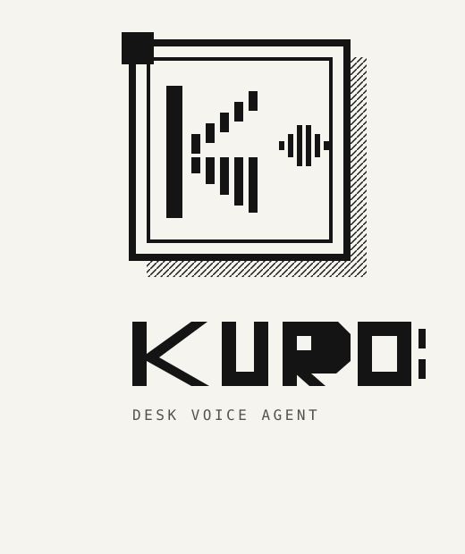

# Kuro

Windows desk voice agent. Hold **Ctrl+Alt+Space**, speak, release. Local Whisper
STT, phrase-first routing, Kokoro/Piper TTS. Optional local LLM via Ollama.

This repo is being shaped as a public template. See
[docs/plans/README.md](docs/plans/README.md) and [AGENTS.md](AGENTS.md).

## Requirements

- Windows 10 19041+ (x64, AVX2 recommended)
- Rust stable (see `kuro-rs/rust-toolchain.toml`)
- .NET 10 SDK
- LLVM (libclang) and MSVC build tools for native crates

## Quickstart

```powershell
git clone <this-repo>
cd Kuro
cargo run -p kuro-cli -- init --defaults
.\scripts\Build-KuroNative.ps1
.\scripts\Install-GitHooks.ps1
.\scripts\Start-Kuro.ps1
```

Before every commit:

```powershell
cargo xtask gate fast
```

After clone, run `cargo run -p kuro-cli -- init --defaults` to install the example
profile under `%LOCALAPPDATA%\Kuro\profile` (or `KURO_DATA_DIR\profile`). Use
`cargo run -p kuro-cli -- doctor` or `doctor --json` before reporting issues.
Optional: copy `.env.example` to a gitignored `.env` for developer overrides.

Optional adapters (Meet, WhatsApp, remote hub, n8n) stay **off** until you set
their env keys. There is no hard-coded LAN or Tailscale address in the product
defaults.

## Layout

| Path | Role |
|------|------|
| `kuro-rs/` | Engine, router, tools, IPC |
| `KuroShell/` | WinUI tray, HUD, settings |
| `contract/v1/` | Golden API/HUD fixtures |
| `docs/adr/` | Architecture decisions |
| `docs/plans/` | Phase plan (00 to 26) |

## License

MIT. See [LICENSE](LICENSE) and [THIRD_PARTY_NOTICES.md](THIRD_PARTY_NOTICES.md).
