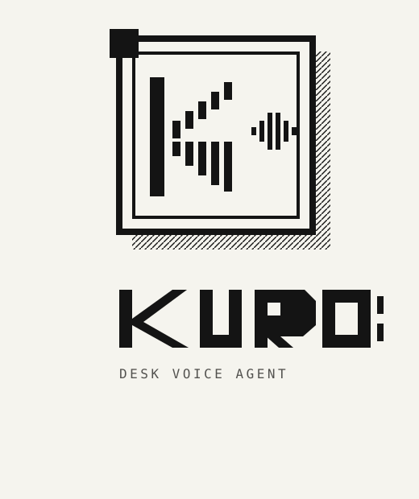

Kuro is a Windows desk voice agent. Hold Ctrl+Alt+Space, speak, and release. Faster-Whisper turns the audio into text. A local phrase route handles the desk plug, music, and news. Anything else goes to the local model. Replies are spoken with XTTS.

The desk plug and the news feed stay on the hub at `http://100.78.60.50:18200`. Mail goes out through Telegram via n8n Cloud. The hotkey is handled in Python with pynput, not by the shell.

## Shell and engine

The voice engine is the Python process (`run_kuro.py` and `main.py`). It can run headless, with its own tray, when the Windows shell is not open.

`KuroShell` is the WinUI 3 window and the always-on-top mark at the bottom of the screen. When the shell is running it owns the tray and the on-screen mark, and it starts the engine with `KURO_API=on`. The engine then serves `127.0.0.1:8765`. The token for that API stays in `%LOCALAPPDATA%\Kuro\api_token` and is never written to the repo.

## Run

From the repo root, with the virtualenv already created:

```powershell
.\scripts\Start-Kuro.ps1
```

To use the window and the bottom mark, start the shell instead:

```powershell
.\KuroShell\KuroShell\bin\x64\Debug\net10.0-windows10.0.19041.0\win-x64\KuroShell.exe
```

Build that shell with:

```powershell
dotnet build .\KuroShell\KuroShell\KuroShell.csproj -c Debug -p:Platform=x64
```

Stop `KuroShell.exe` before rebuilding, or the output file stays locked.

Brand files live in `assets/branding/`. Regenerate the icon and the tray images with:

```powershell
.\.venv\Scripts\python.exe .\scripts\build_icons.py
```

## Brand

Paper `#F5F4EE`, white `#FFFFFF`, ink `#141414`, muted `#52514E`. Corners are square. Titles use Space Grotesk. Labels use JetBrains Mono. Both are bundled under `KuroShell/KuroShell/Assets/Fonts` with their OFL licenses.
